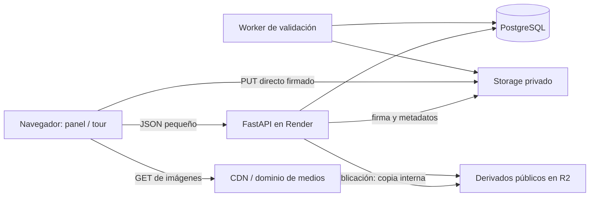

# Vista360 — arquitectura y plan incremental

Fecha: 13 de octubre de 2026. Estado: propuesta para revisión, sin implementación.

## 1. Estado del proyecto y alcance de esta tarea

El directorio `/Users/emilianofaro/Desktop/vista360` está vacío al comenzar. No contiene código, dependencias, configuración, `AGENTS.md` ni repositorio Git. No hay una aplicación existente que preservar o migrar.

Esta entrega crea únicamente este documento. Las carpetas, tablas, endpoints y contratos siguientes son propuestas; no se han generado ni ejecutado. La implementación comenzará después de la revisión del plan, explicando el alcance de cada fase antes de desarrollarla.

## 2. Análisis del producto y MVP

El producto inicial es un editor de recorridos basados en fotografías panorámicas. Un recorrido contiene escenas ordenadas; cada escena muestra una panorámica; los hotspots definen navegación o información. No existe desplazamiento físico continuo ni reconstrucción espacial en este modelo.

La prioridad es completar el flujo crear → cargar → conectar → previsualizar → publicar. La fuente inicial son panoramas equirectangulares completos de cámaras 360, ya preparados para visualizar. Una foto panorámica parcial tomada con el modo panorámico del teléfono no equivale a una esfera completa.

### Incluido en el MVP completo, en fases posteriores

- Registro, login, logout y sesiones revocables; autorización por propietario.
- Crear, listar, editar y eliminar recorridos propios; título, descripción y slug único.
- Crear, renombrar, ordenar y eliminar escenas; elegir escena inicial y orientación inicial.
- Una panorámica activa por escena; carga JPEG equirectangular completa 2:1, validación y reemplazo.
- Visor con giro libre, zoom, controles táctiles y selección de ambiente en desktop, tablet y celular.
- Hotspots de navegación e información textual; crear, editar y eliminar desde el visor.
- Previsualización privada del borrador.
- Publicación explícita, actualización de la versión publicada y despublicación.
- URL pública `/tour/{slug}` sin login y sin acceso a información privada del propietario.
- Errores y progreso visibles durante carga, validación, navegación y publicación.

JPEG es una restricción inicial deliberada: HEIC, RAW, panoramas parciales y videos requerirán conversión antes de cargar. Los límites se comunicarán en el editor.

### Fuera del MVP

Captura guiada, stitching, IA, LiDAR, fotogrametría, NeRF, Gaussian Splatting, planos, analytics, leads, formularios, WhatsApp, hotspots de fotografías/medidas/precios, branding, dominios propios de clientes, iframe oficial, QR, organizaciones, múltiples agentes, pagos, planes, suscripciones y tours con contraseña.

También quedan fuera un motor WebGL propio, una app móvil nativa, microservicios, Kubernetes y una plataforma general de procesamiento multimedia. Se contempla una validación y una derivación JPEG limitada para entrega móvil; la optimización automática avanzada, thumbnails automáticos y mosaicos multirresolución se incorporarán después según mediciones.

## 3. Arquitectura concreta

Monorepo con frontend y backend desplegables de manera independiente. Backend como monolito modular; las operaciones de negocio residen en servicios y no en los handlers HTTP.

| Componente | Decisión | Responsabilidad |
| --- | --- | --- |
| Frontend | React + TypeScript + Vite | Panel, editor y recorrido público |
| Visor | Pannellum detrás de un adaptador propio | Renderizado 360 y coordenadas de hotspots |
| API | Python + FastAPI + Pydantic | Identidad, autorización, metadatos, validación y publicación |
| Persistencia | PostgreSQL + SQLAlchemy + Alembic | Datos relacionales, sesiones y versiones publicadas |
| Storage | Interfaz propia, adaptadores local y S3/R2 | Archivos, cargas firmadas y URLs de lectura |
| Procesamiento básico | Proceso worker del mismo backend | Validar archivos y preparar derivado de entrega |
| Desarrollo | PostgreSQL local y directorio local de archivos | Sin cuentas ni servicios pagos obligatorios |
| Producción prevista | Vercel, Render, PostgreSQL, R2/CDN | Frontend, API/worker, datos y entrega de archivos |



El worker ejecutará tareas durables registradas en PostgreSQL, con reclamación mediante bloqueo, reintentos limitados y expiración de leases. Evita Redis/Celery inicialmente y no depende de tareas en memoria de FastAPI que se perderían al reiniciar. Comparte código con la API, pero ejecuta decodificación fuera de los procesos HTTP. En local corre como otro comando; el despliegue del worker se evaluará según los recursos disponibles, sin asumir que el hosting será gratuito.

Dependencias futuras justificadas: router para las rutas SPA; controlador PostgreSQL; biblioteca de hashing Argon2; decodificador JPEG como Pillow; SDK S3 únicamente al habilitar ese adaptador. Usar `fetch` y estado React inicialmente; incorporar otras librerías cuando exista una necesidad concreta. Fijar versiones y lockfiles al implementar, comprobando compatibilidad y avisos de seguridad entonces.

## 4. Elección del visor

**Decisión: Pannellum para el MVP**, integrado mediante su API JavaScript, sin iframe interno ni wrapper React de terceros.

| Criterio | Pannellum | Marzipano |
| --- | --- | --- |
| Licencia del proyecto | MIT | Apache 2.0 |
| React | API imperativa dentro de componente con ref y cleanup | Integración imperativa equivalente |
| Hotspots | Tipos `scene` e `info`, callbacks y estilos | Elementos DOM, gran flexibilidad |
| Múltiples escenas | Configuración de tour y cambio por API | Escenas y transiciones por API |
| Equirectangular | Soporte directo | Soporte directo |
| Personalización | CSS y callbacks suficientes para el MVP | Más control de componentes de bajo nivel |
| Móvil | Interacción táctil; validar memoria y tamaño de textura | Interacción táctil; mismos cuidados de GPU/memoria |
| Alta resolución | Soporta multirresolución con preparación previa | Buen modelo de geometrías y tiles |
| Mantenimiento observado | Release 2.5.7 con correcciones de seguridad | Repositorio oficial archivado el 20/04/2026 |

Fuentes: [licencia Pannellum](https://github.com/mpetroff/pannellum/blob/master/COPYING), [licencia Marzipano](https://github.com/google/marzipano/blob/master/LICENSE), [documentación Marzipano](https://www.marzipano.net/docs.html), [geometría equirectangular](https://www.marzipano.net/reference/EquirectGeometry.html) y [repositorio Marzipano](https://github.com/google/marzipano).

La decisión prioriza el alcance inmediato y el mantenimiento observado, no una superioridad de rendimiento demostrada. La [release Pannellum 2.5.7](https://github.com/mpetroff/pannellum/releases/tag/2.5.7) corrige riesgos de XSS; al implementar se elegirá una versión vigente que incluya esas correcciones. El archivo histórico lleva el nombre COPYING; el texto actual consultado corresponde a MIT. Conservar avisos de licencia de las versiones y dependencias efectivamente distribuidas.

El adaptador expondrá cargar escena, cambiar orientación, obtener coordenadas de un clic, agregar/quitar hotspot y destruir instancia. React controla formularios y estado; Pannellum controla su contenedor. Crear una instancia al montar, retirar listeners y destruirla al desmontar, incluyendo el comportamiento de StrictMode y resize.

La [API oficial](https://pannellum.org/documentation/api/) proporciona `mouseEventToCoords` (retorna `[pitch, yaw]`), `loadScene`, `addHotSpot`, `removeHotSpot`, `resize` y `destroy`. La [referencia](https://pannellum.org/documentation/reference/) describe tipos `scene`/`info`, destino y orientación en grados. La app transformará sus propios DTO a esa configuración; la base no guardará JSON específico del visor.

Prueba técnica previa al editor: panorama propio o con permiso, interacción táctil, hotspot y cambio entre dos escenas, conversión de clic, limpieza de instancia y carga desde otro origen con CORS. Medir en Safari iOS y Chrome Android; no asumir que todos admiten imágenes enormes. Pannellum también tiene [multirresolución](https://pannellum.org/documentation/examples/multiresolution/), que permite evolucionar la entrega sin cambiar de motor.

## 5. Estructura propuesta de carpetas

Crear cada módulo cuando su fase lo necesite, sin generar ahora directorios vacíos.

```text
vista360/
├── PLAN.md
├── README.md
├── .gitignore
├── compose.yaml                  # PostgreSQL para desarrollo
├── docs/                         # contratos y decisiones posteriores
├── frontend/
│   ├── package.json
│   ├── .env.example
│   ├── index.html
│   ├── vite.config.ts
│   └── src/
│       ├── app/                  # rutas, layout, arranque
│       ├── features/
│       │   ├── auth/
│       │   ├── tours/
│       │   ├── editor/
│       │   └── public-tour/
│       ├── viewer/               # contrato, componente, adaptador Pannellum
│       ├── api/                  # cliente fetch y tipos desde OpenAPI
│       ├── components/           # UI compartida
│       └── styles/
└── backend/
    ├── pyproject.toml
    ├── .env.example
    ├── alembic.ini
    ├── migrations/
    ├── tests/
    └── app/
        ├── main.py
        ├── core/                 # settings, seguridad y errores
        ├── db/                   # sesión SQLAlchemy y base de modelos
        ├── modules/
        │   ├── auth/
        │   ├── tours/
        │   ├── scenes/
        │   ├── hotspots/
        │   ├── assets/
        │   └── publication/
        ├── storage/              # protocolo, local, S3/R2
        └── processing/           # worker, tareas y validadores
```

Cada módulo backend contendrá modelos SQLAlchemy, schemas Pydantic, router y servicio cuando corresponda. No agregar repositorios genéricos que sólo dupliquen SQLAlchemy. La transacción pertenece al caso de uso; la serialización de respuestas siempre es explícita. Contratos frontend generados desde OpenAPI cuando haya endpoints, evitando compartir modelos de persistencia.

## 6. Esquema inicial propuesto para PostgreSQL

IDs UUID generados por la aplicación, fechas `timestamptz` en UTC. Estados y tipos como texto con CHECK para permitir evolución mediante migraciones. Columnas críticas relacionales; JSONB reservado para metadatos variables y el documento publicado. `updated_at` debe actualizarse explícitamente en cada mutación.

| Tabla | Columnas principales |
| --- | --- |
| `users` | `id`, `email_normalized` UNIQUE, `password_hash`, `created_at`, `updated_at` |
| `auth_sessions` | `id`, `user_id` FK, `token_hash` UNIQUE, `expires_at`, `revoked_at`, `created_at` |
| `tours` | `id`, `owner_id` FK users, `title`, `slug` UNIQUE, `description`, `status` (`draft`/`published`), `start_scene_id` nullable, `revision` bigint, `published_version_id` nullable, `created_at`, `updated_at` |
| `scenes` | `id`, `tour_id` FK tours, `name`, `content_type` (`panorama_360` inicialmente), `panorama_asset_id` nullable, `thumbnail_asset_id` nullable, `sort_order` integer, `initial_yaw`, `initial_pitch`, `initial_hfov`, `created_at`, `updated_at` |
| `hotspots` | `id`, `tour_id`, `scene_id`, `type` (`navigation`/`info`), `yaw`, `pitch`, `label`, `target_scene_id` nullable, `content` JSONB, `created_at`, `updated_at` |
| `assets` | `id`, `tour_id` FK tours, `type` (`panorama_original`/`panorama_delivery`/`thumbnail` inicialmente), `source` (`camera_360`/`manual_upload`), `parent_asset_id` nullable, `storage_backend`, `storage_key`, `mime_type`, `size_bytes` bigint, `width`, `height`, `checksum_sha256`, `status` (`pending`/`processing`/`ready`/`rejected`), `metadata` JSONB, `created_at`, `updated_at` |
| `processing_jobs` | `id`, `asset_id` FK, `kind`, `status`, `attempts`, `available_at`, `lease_expires_at`, `error_code`, `created_at`, `updated_at` |
| `tour_publications` | `id`, `tour_id` FK tours, `version` integer, `schema_version` integer, `document` JSONB, `created_at`; UNIQUE (`tour_id`, `version`) |

`panorama_url` y `thumbnail_url` serán campos calculados de respuesta, derivados del asset y del contexto privado/público. No almacenar URLs firmadas que caducan ni acoplar el esquema a un hostname.

### Integridad, índices y eliminación

- Índices por `tours(owner_id)`, `scenes(tour_id, sort_order)`, `hotspots(scene_id)`, `hotspots(target_scene_id)`, `assets(tour_id, status)`, sesiones por usuario y tareas por estado/fecha.
- `slug` canónico ASCII minúsculo, validado, con índice UNIQUE global; resolver colisiones también ante concurrencia. Mantenerlo estable después de publicar en el MVP, para evitar enlaces rotos.
- UNIQUE (`id`, `tour_id`) en escenas, assets y publicaciones. FKs compuestas para escena origen/destino del hotspot, assets de escena, asset padre, escena inicial y publicación activa. Así ninguna referencia puede cruzar recorridos.
- CHECK: `navigation` exige destino y no payload informativo; `info` exige destino NULL y payload validado, inicialmente `{ "text": "..." }`. Validar forma/longitud en Pydantic y forma básica en PostgreSQL.
- Ángulos finitos en grados: yaw normalizado a `[-180, 180)`, pitch entre `-90` y `90`. FOV con rango configurable seguro. `sort_order >= 0`, tamaño positivo y dimensiones positivas cuando el asset esté listo.
- UNIQUE (`tour_id`, `sort_order`) diferible para reordenar escenas dentro de una transacción. El endpoint recibe la lista completa de IDs, sin duplicados ni omisiones.
- Crear tours primero con escena inicial y publicación NULL; añadir las FKs cíclicas en un paso posterior de la migración. Al eliminar un tour, limpiar referencias activas dentro de la transacción antes de borrar sus hijos.
- Bloquear eliminación de escenas con hotspots entrantes, salvo confirmación explícita que borre también esas conexiones. Si es la escena inicial, seleccionar reemplazo. La UI mostrará el impacto.
- Un asset se borra físicamente sólo cuando no lo referencian escenas ni publicaciones retenidas. Guardar IDs de assets en el snapshot; el servicio de limpieza comprobará ambas referencias antes de eliminar. Borrado DB y object storage no son atómicos: usar tarea durable y reintentos.

Este esquema añade sólo sesiones, tareas de ingestión y versiones para resolver necesidades del MVP. Organizaciones, facturación y captura no tienen tablas todavía. En una etapa multiempresa se agregará organización/membresía y se migrará la política de propietario a permisos; las referencias internas siguen basadas en `tour_id`.

## 7. Imágenes: carga, validación y entrega

### Abstracción de almacenamiento

Contrato conceptual: preparar carga, inspeccionar objeto, leer para procesamiento, escribir derivado, generar lectura privada, copiar para publicación y borrar. `prepare_upload` devuelve URL, método, headers y expiración; así local y S3 pueden ofrecer transportes distintos sin cambiar el flujo de negocio.

Local: archivos fuera del código y de Git; carga limitada por streaming a FastAPI sólo en desarrollo. Lectura privada mediante endpoint autorizado; derivados públicos de prueba en una ruta estática separada. Rechazar traversal y resolver claves generadas por el servidor.

Producción: buckets separados para originales/borradores privados y derivados públicos. Claves opacas como `tours/{tour_uuid}/assets/{asset_uuid}/{version}.jpg`, nunca nombres aportados por el usuario. Credenciales sólo en API/worker.

### Flujo de carga

1. Cliente pide autorización de carga; API comprueba sesión, propietario, formato declarado, cuota y límite, y crea asset `pending`.
2. API entrega PUT firmado de corta duración (propuesta: 10 minutos) hacia bucket privado. Navegador sube directamente a R2/S3 y luego confirma el asset a la API.
3. API comprueba tamaño y existencia mediante storage; crea tarea idempotente. No confía en MIME, extensión o dimensiones declaradas por el navegador.
4. Worker lee el archivo una vez, verifica firma JPEG, decodificación completa, dimensiones, proporción exacta 2:1, límites de píxeles y memoria. Rechaza corruptos y formatos no admitidos.
5. Worker escribe un derivado privado en una clave nueva y controlada, eliminando metadatos innecesarios. Marca `ready` y permite asociarlo a una escena. Si falla, marca `rejected`, limpia objetos y devuelve un error comprensible.

Nunca servir directamente el objeto de carga como panorama aprobado: una URL PUT puede reutilizarse hasta expirar. El derivado aprobado tiene otra clave que el cliente no puede sobrescribir.

Límites iniciales propuestos para validar con fotografías reales: 50 MiB por original, máximo 16.384 × 8.192 y presupuesto de 135 millones de píxeles, con worker de memoria suficiente y concurrencia limitada. Derivado inicial hasta 4.096 × 2.048, JPEG calidad aproximada 85. Son parámetros revisables, no garantías de compatibilidad de todo móvil; reducir el derivado cuando la GPU no soporte su textura y medir legibilidad al ampliar.

La firma de Content-Type no verifica contenido ni garantiza un límite de tamaño para PUT en todos los proveedores. Comprobar tamaño real después de la carga, restringir reservas/cuotas y limpiar pendientes vencidos. Es posible que un archivo excedido llegue al storage antes de rechazarse. La [documentación de R2 sobre firmas](https://developers.cloudflare.com/r2/api/s3/presigned-urls/) describe PUT/GET, CORS y firma del tipo de contenido; las URLs firmadas usan el dominio S3, no dominios personalizados.

### Publicación y ancho de banda

Los originales permanecen privados. Al publicar se copian derivados aprobados al bucket público mediante copia interna del proveedor; la API transmite comandos y JSON, no los bytes. En preview usar GET firmado privado con renovación por escena, sin guardar la firma en DB. En público usar URLs estables del dominio de medios con CDN.

R2 permite caché mediante dominio personalizado; `r2.dev` está destinado a desarrollo y tiene límites. Configurar reglas explícitas para los tipos de medios utilizados. Fuente: [buckets públicos R2](https://developers.cloudflare.com/r2/buckets/public-buckets/).

Imágenes versionadas: `Cache-Control: public, max-age=31536000, immutable`. Cargar sólo la imagen de la escena activa; no precargar todas las panorámicas. Inicialmente sin precarga especulativa móvil. Liberar recursos de escenas al cambiar; descargar el JSON del recorrido una vez y reutilizarlo. Los thumbnails son opcionales: usar placeholder antes de implementar su generación.

Procesar una imagen implica una transferencia de ingestión al worker; es distinta de servirla por cada visita. Ningún GET de imagen público pasa por Render. Más adelante, tiles multirresolución pueden reducir transferencias y memoria para panoramas grandes; requieren una tarea adicional de conversión y mediciones, no únicamente activar una opción del visor.

Los derivados publicados son accesibles a quien conserve su URL. Despublicar retira la ruta del tour y programa borrado/purga de los objetos públicos sin referencias; no puede retirar copias descargadas ni garantizar revocación inmediata de caches. Tours privados futuros requerirán un modo de entrega autorizado diseñado expresamente.

## 8. Conexiones, editor y publicación

El recorrido es un grafo dirigido: las escenas son nodos y cada hotspot `navigation` es una arista. Living → Cocina no crea automáticamente Cocina → Living. Pueden existir varios accesos al mismo destino. `sort_order` sólo ordena la lista lateral, no determina conexiones.

Ejemplo de datos conceptuales:

```json
{
  "scene_id": "uuid-living",
  "type": "navigation",
  "yaw": 35.2,
  "pitch": -12.0,
  "label": "Ir a Cocina",
  "target_scene_id": "uuid-cocina",
  "content": null
}
```

En modo agregar, el editor convierte un clic a yaw/pitch mediante el adaptador y abre el formulario. En modo mirar, arrastrar sólo mueve la cámara; distinguir clic y arrastre, y probar equivalente táctil. Guardar el hotspot únicamente al confirmar el formulario. Mostrar botones accesibles y lista de escenas como alternativa de navegación.

Al navegar se usa la orientación inicial del destino. No inferir continuidad espacial entre fotografías. Orientación específica por conexión y alineación con norte quedan para una ampliación posterior.

Publicar valida al menos una escena, escena inicial válida, panorama listo por escena y todos los destinos existentes dentro del tour. Advertir sobre escenas no alcanzables por hotspots desde el inicio; siguen accesibles desde la lista. Generar snapshot propio, versionado y sin datos del usuario ni credenciales.

La publicación captura `revision`; prepara las copias públicas y verifica de nuevo esa revisión antes de activar el snapshot en una transacción. Si hubo edición concurrente, abortar y pedir republicar. Copias fallidas no activan una publicación parcial; limpiar las sobrantes de manera durable. Mantener la publicación anterior ante fallos.

Editar modifica el borrador y aumenta su revisión. El recorrido público conserva el snapshot activo hasta republicar; la UI indica cambios pendientes. El endpoint público responde 404 para tours no publicados y nunca serializa el borrador. Propuesta de cache del JSON público: ETag por publicación y revalidación obligatoria (`max-age=0, must-revalidate`); previews y respuestas de sesión `no-store`.

## 9. API, seguridad y despliegue

Rutas previstas bajo `/api/v1`: sesiones/registro, recorridos propios, escenas, reordenamiento, hotspots, preparar/completar carga, estado de assets, preview, publicar y despublicar. Endpoint público separado `GET /api/v1/public/tours/{slug}`. Recursos hijos siempre resueltos en el contexto de un tour autorizado; conocer un UUID no concede permisos.

Login propuesto con tokens de sesión opacos aleatorios, hash persistido, expiración y revocación. Cookie HttpOnly, Secure en producción y SameSite apropiado; hashing de contraseñas Argon2. Mutaciones protegidas frente a CSRF mediante token y validación de origen. Limitar intentos de login y cargas; no registrar contraseñas, cookies ni firmas de storage.

Para producción, preferir frontend y API en subdominios del mismo sitio (por ejemplo `app.<dominio>` y `api.<dominio>`), aunque estén alojados en Vercel/Render. Configurar CORS con lista exacta y credenciales, y `fetch` con credentials. Los dominios por defecto de ambos proveedores serían cross-site: requieren otra política de cookies y pruebas frente a restricciones del navegador. Resolver antes del despliegue, sin usar localStorage como atajo para sesiones.

Textos tratados como texto plano, sin HTML arbitrario ni configuración del visor aportada directamente por usuarios. React escapa textos; usar `textContent` en hotspots DOM. No incorporar URLs externas de panorama suministradas por el cliente: evita SSRF y dependencias de orígenes inseguros. No aceptar opciones arbitrarias de hotspots como atributos HTML.

Configuración backend por entorno: conexión DB, orígenes frontend, cookie, storage backend, directorio local, endpoint/buckets S3, credenciales, dominio público de medios y límites. Frontend sólo variables públicas como base URL de API; ningún secreto con prefijo `VITE_`. Incluir ejemplos sin credenciales cuando se cree la base.

Deploy: build estático Vite en Vercel con fallback SPA para `/tour/{slug}`; API y worker en Render; PostgreSQL persistente; storage externo. El disco de Render no es almacenamiento de producción. Ejecutar migraciones como paso controlado de release, no en cada arranque concurrente. Logs estructurados, healthcheck, backups y restauración comprobada antes de usuarios reales. El dominio de medios es infraestructura; no implica implementar dominios personalizados para clientes.

## 10. Preparación para captura móvil y 3D

El límite de integración es un asset aprobado, no el dispositivo que lo produjo. `Asset.source`, metadatos versionados, relación padre/derivado, estados de ingestión y `Scene.content_type` permiten sumar productores sin rehacer el editor actual.

En una futura fase de captura se agregarán `capture_sessions` y `capture_frames`: tour/escena, usuario, estado, orden de frames, asset original, timestamp, orientación, calibración y manifiesto versionado. Definir unidades y sistema de coordenadas; no guardar grandes series de sensores en filas de escenas. Imágenes y registros extensos van a storage privado.

Flujo futuro: iniciar sesión → guiar captura → cargar frames reanudables → validar cobertura → ejecutar stitching en worker especializado → producir asset equirectangular → validar con el mismo contrato actual → asociar a escena. Los trabajos costosos no se ejecutan en un request HTTP y tienen progreso, reintentos e idempotencia.

Antes de implementar: investigar mediante un prototipo HTTPS qué permisos, cámaras y sensores ofrecen Safari iOS y Chrome Android. La captura se basa en rotación alrededor del centro óptico, con solapamiento suficiente; escenas cercanas, movimiento y paralaje pueden impedir un stitching correcto. No prometer una esfera completa a partir de un giro horizontal ni calidad equivalente a cámara 360. Si la web limita la captura, una app nativa puede producir los mismos assets mediante la API.

Contenido 3D futuro tendrá assets como nube de puntos/modelo/splat y metadatos espaciales, junto con un renderer distinto elegido por `content_type`. Mantener panorama como respaldo. Hotspots angulares y posiciones XYZ tienen contratos distintos; añadir representación espacial cuando exista un caso real, sin fingir que yaw/pitch resuelve navegación 3D. No instalar dependencias de reconstrucción ni crear campos vacíos para todos esos formatos ahora.

## 11. Fases y criterios de cierre

| Fase | Trabajo | Criterio de cierre |
| --- | --- | --- |
| 0 — ahora | Análisis y este PLAN.md | Usuario revisa alcance y decisiones; detenerse aquí |
| 1 — base | Inicializar Git, Vite/React/TS, FastAPI, settings, PostgreSQL local, Alembic, healthcheck, README y ejemplos de entorno | Arranque reproducible sin servicios pagos; build frontend y conexión/migración DB verificados |
| 2 — prueba de visor | Adaptador Pannellum y dos panoramas autorizados de prueba | Giro/touch, hotspots, coordenadas y cleanup comprobados en desktop y móviles; decisión de tamaño documentada |
| 3 — identidad y recorridos | Migraciones User/sesiones/Tour/Scene, auth, permisos y CRUD básico | Un usuario no puede consultar ni modificar recursos de otro; slug concurrente y orden transaccional verificados |
| 4 — ingestión | Assets/tareas, storage local/S3, cargas directas, validación, derivado y reemplazo | JPEG válido listo para preview; corrupto/excedido rechazado; pendientes limpiados; ningún archivo público sin aprobación |
| 5 — editor | Lista de escenas, giro inicial, hotspots de navegación/info y preview privado | Crear Living → Cocina, volver con otro hotspot, editar/eliminar y persistir tras recarga |
| 6 — publicación | Snapshot, URL pública, republicación, despublicación y CDN | Borrador aislado; fallos no alteran publicación previa; recorrido usable en desktop/tablet/celular; imágenes fuera de Render |
| 7 — preparación productiva | Hardening, cuotas/rate limits, checks de accesibilidad, observabilidad, backups y deploy | Flujo MVP completo verificado; recuperación y permisos probados; secretos y CORS configurados |
| 8 — posteriores | Thumbnails, tiles y mejoras basadas en mediciones; luego analytics/leads/organizaciones | Priorizar según uso, sin ampliar anticipadamente el MVP |
| 9 — investigación | Captura móvil/stitching y, en otro esfuerzo, contenido 3D | Prototipos y evaluación de calidad/coste antes de comprometer implementación |

Las fases 1 a 7 construyen el MVP de forma incremental. Antes de cada funcionalidad grande se explicará qué se implementa, su alcance y validación. No hay fechas prometidas sin estimar el trabajo tras la revisión.

### Validación de las fases de implementación

- Backend con PostgreSQL real de prueba: autorización cruzada, integridad entre tours, colisiones de slug, orden, cargas inválidas, reintentos y publicación concurrente.
- Frontend: pruebas focalizadas de la integración del visor y flujo crear/cargar/conectar/publicar; comprobación manual de GPU/touch en dispositivos reales.
- Rendimiento: bytes transferidos por escena, tiempo de primera visualización, memoria al cambiar ambientes y ausencia de precarga global; definir objetivos con muestras reales en la fase 2.
- Storage: comprobar PUT/GET firmado, expiración, CORS, separación privado/público y headers/cache. No simular que local demuestra compatibilidad completa con R2.

## 12. Decisiones propuestas para revisión

Pannellum; monolito modular; PostgreSQL; JPEG completo 2:1 como entrada inicial; assets referenciados por ID; grados para hotspots; sesiones opacas; borrador separado de snapshot publicado; originales privados y derivados públicos por CDN; worker básico sin Redis; captura y 3D pospuestos con contratos de ingestión extensibles.

**Punto de detención:** sólo se entrega PLAN.md. No se instala nada ni se implementan autenticación, funcionalidades del SaaS, pagos, stitching, IA o reconstrucción 3D.
